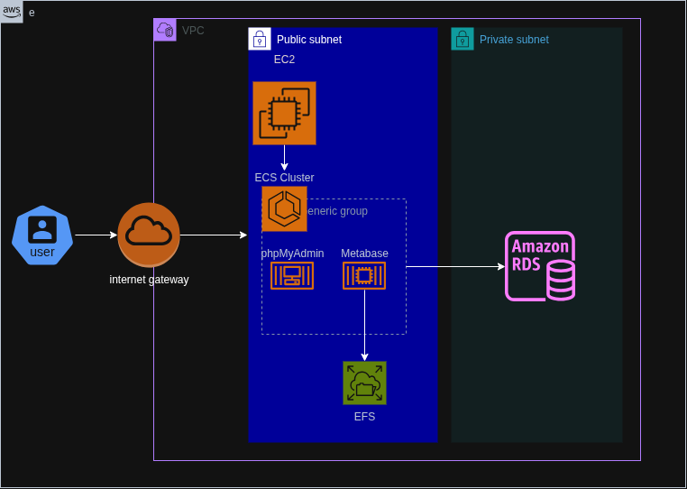
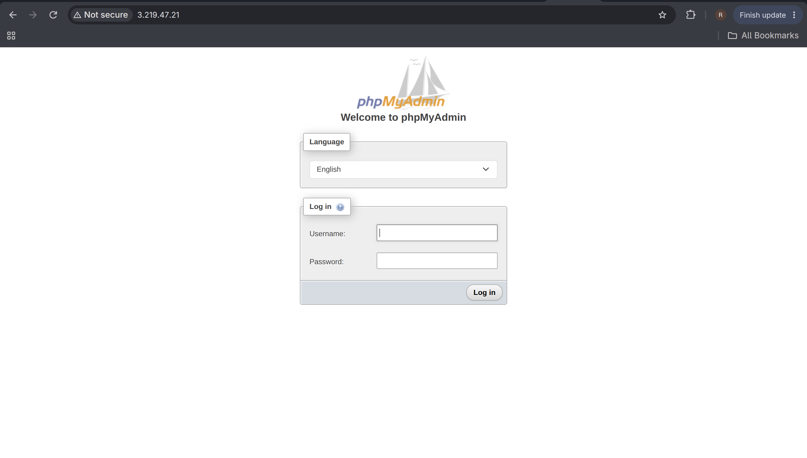
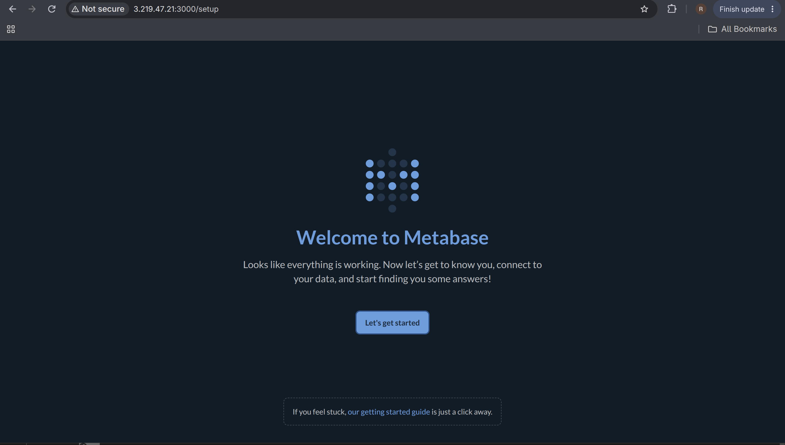
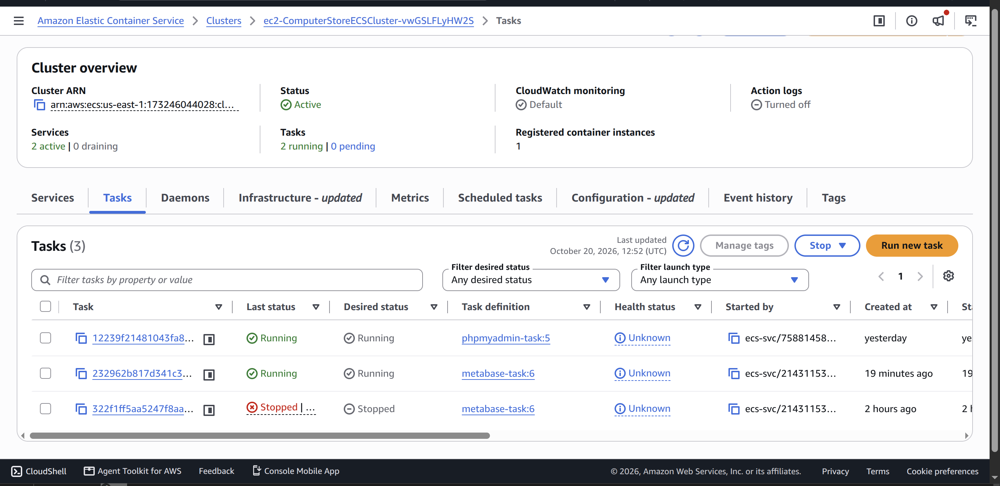
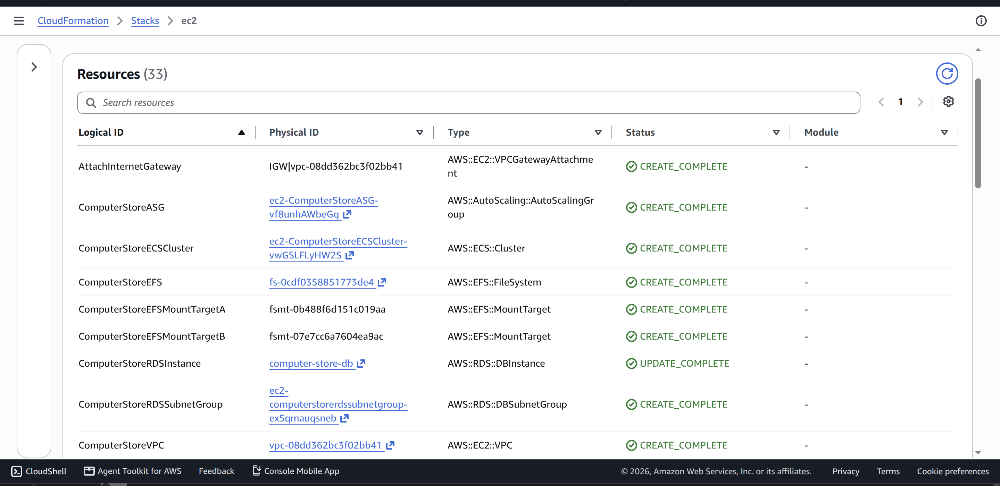
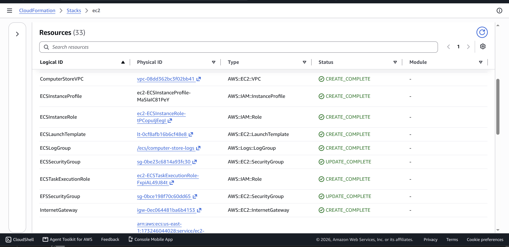
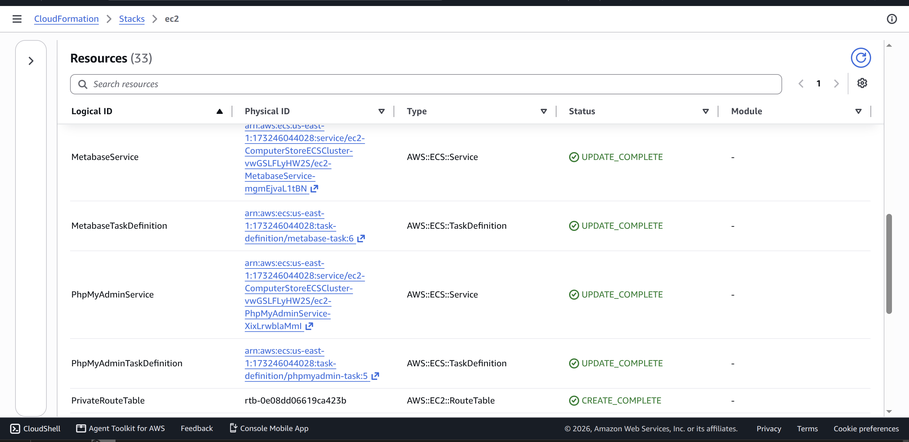
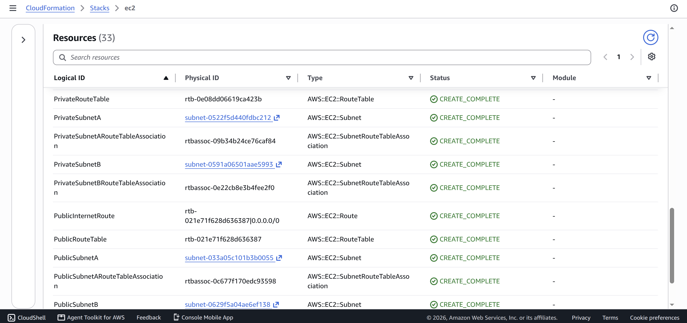
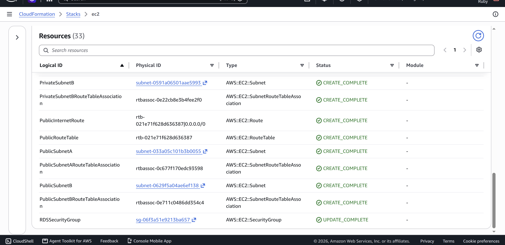

# Somputer-Store-ECS-Cloudformation

A Computer Store environment deployed using AWS CloudFormation. This
project is an opportunity for me to learn more about AWS and get
hands-on practice with infrastructure as code. I used CloudFormation to
create the network, EC2 capacity for ECS, the containers for phpMyAdmin
and Metabase, an RDS MySQL database, EFS storage, and CloudWatch
logging.

The goal was to build the infrastructure from a template instead of
creating each resource manually, then get both applications running and
understand how the resources connect.



## Architecture decisions

### Public and private subnets

I created a VPC with two public subnets and two private subnets across
two Availability Zones. The ECS EC2 instances are launched in the public
subnets so they can receive public IP addresses and serve the
applications directly. The RDS database is in the private subnets and is
not publicly accessible.

The public subnets use a route table with a default route to the
Internet Gateway. The private subnets have their own route table, but I
did not add a NAT Gateway or a NAT route in this template.

### ECS on EC2

I used Amazon ECS with the EC2 launch type instead of Fargate. The Auto
Scaling Group starts with one instance and is configured for a minimum
of one and a maximum of two instances. The launch template uses a
`t3.small` instance and configures the instance to register with my ECS
cluster.

The two containers run on the ECS cluster: - phpMyAdmin uses host port
`80`. - Metabase uses host port `3000`.

I used fixed host ports because I wanted to access each application
through the EC2 instance's public IP address. The services use
`MinimumHealthyPercent: 0` and `MaximumPercent: 100` so ECS can stop an
existing task before starting its replacement. This can cause a short
interruption during deployment, but it helps when the old task is
already using the host port the new task needs.

### RDS and phpMyAdmin

I used Amazon RDS for MySQL as the database and phpMyAdmin as the web
interface for managing it. The RDS instance is configured with the
`db.t4g.micro` instance class, 20 GiB of gp3 storage, and
`PubliclyAccessible: false`.

The phpMyAdmin task gets the database endpoint from the CloudFormation
resource using the `PMA_HOST` environment variable. The RDS security
group only allows inbound MySQL traffic on port `3306` from the ECS
security group. This means the database is not directly open to the
internet.

### EFS for Metabase

I created an encrypted EFS file system with mount targets in both
private subnets. The Metabase task mounts it at `/metabase-data` and
stores its file-based application database at
`/metabase-data/metabase.db`.

I used EFS so the Metabase application data would live outside the
container's writable layer. In this version, Metabase is using its
file-based application database on EFS. I would consider using a
dedicated external application database, such as PostgreSQL, for a
production deployment.

### Security groups

The ECS security group allows inbound traffic on ports `80` and `3000`.
I left both ports open to `0.0.0.0/0` because my public IP changes and I
wanted to access the applications without updating the rules each time.

The trade-off is that the web interfaces can be reached from anywhere on
the internet. I would not use this configuration for a production
environment, especially for phpMyAdmin. A future improvement would be to
put the applications behind an authenticated access layer or use another
approach that does not require opening these ports to everyone.

The EFS security group allows NFS traffic on port `2049` from the ECS
security group. The RDS security group allows MySQL traffic on port
`3306` from the ECS security group.

### IAM and CloudWatch Logs

I created an IAM role and instance profile for the EC2 container
instances, and an ECS task execution role for the tasks. The task
execution role uses the AWS-managed `AmazonECSTaskExecutionRolePolicy`.

I also created a CloudWatch log group named `/ecs/computer-store-logs`
with seven-day retention. Both the phpMyAdmin and Metabase task
definitions use the `awslogs` log driver. I added this because having
container logs makes it easier to investigate startup and runtime
issues.

## Problems

### Metabase memory and task placement

I initially ran into problems with Metabase starting and staying
available. ECS reported that there was not enough memory to place a
task, and one stopped Metabase task had an `OutOfMemoryError` with exit
code `137`.

I reviewed the container resource settings and adjusted the task CPU and
memory values. The current template reserves 799 CPU units and 1331 MiB
of memory for Metabase, and 224 CPU units and 195 MiB for phpMyAdmin.
The EC2 instance is still small, so this is something I would continue
monitoring rather than assume the capacity is unlimited.

### Host-port conflict during deployment

Both services use fixed host ports. During a CloudFormation update, ECS
reported that it could not place a phpMyAdmin task because the container
instance was already using a required port.

I changed the service deployment configuration to use
`MinimumHealthyPercent: 0` and `MaximumPercent: 100`. This lets ECS stop
the old task before starting the replacement, instead of trying to run
both tasks at once on the same host port.

### CloudFormation rollback

An update got stuck while CloudFormation was trying to roll it back. The
stack remained in `UPDATE_ROLLBACK_IN_PROGRESS`, and later the rollback
failed because of `PhpMyAdminService`. I checked the stack events and
resource statuses to identify the blocker. Since my goal was to start
over, I deleted the stack from the CloudFormation console and redeployed
it.

This taught me to check the CloudFormation events rather than rely only
on the overall stack status, and to be careful about changing ECS
services that need to replace tasks on fixed ports.

### Incorrect EFS property name

During the task definition update, CloudFormation reported that the EFS
volume configuration was missing the required `FilesystemId` property
and that `FileSystemId` was not allowed. I corrected the property name
to `FilesystemId` and validated the template before deploying again.

## Screenshots

I will add screenshots of the working applications and AWS resources
here.

### phpMyAdmin



### Metabase



### ECS services and tasks



### CloudFormation stack











## What I learned

-   How to use CloudFormation to create and connect multiple AWS
    resources.
-   How ECS services, task definitions, EC2 capacity, and host-port
    mappings work together.
-   Why container memory reservations matter when running tasks on a
    small EC2 instance.
-   How RDS security groups can allow database access from an
    application tier without making the database public.
-   How to configure EFS as a task volume and mount it inside a
    container.
-   How CloudWatch Logs helps with container troubleshooting.
-   How to read CloudFormation stack events and recover from a failed
    update.
-   Why a template passing validation does not guarantee that every
    resource will deploy and run successfully.

## Things I would do differently

-   I would avoid leaving phpMyAdmin publicly accessible to everyone and
    use a more restricted access method.
-   I would use pinned container image versions instead of `latest` so
    deployments are more predictable.
-   I would consider a dedicated PostgreSQL database for Metabase
    application data.
-   I would review the EC2 memory requirements and cost before deciding
    how much capacity to run.
-   I would add more health checks and monitoring so I can identify
    application failures earlier.
-   I would check for leftover resources and snapshots after deleting
    the stack, because RDS has `DeletionPolicy: Snapshot` and a snapshot
    can continue to incur storage charges.

## Deployment

This project includes a Python automation script designed to manage the CloudFormation stack through a single interactive entry point. Instead of running separate AWS CLI commands for each operation, users can select the action they want to perform, and the script will handle the corresponding CloudFormation operation.

### Prerequisites

Before running the script, ensure you have:

- An AWS account with the required permissions to manage the project's resources.
- AWS CLI installed and configured with valid credentials.
- Python 3 installed.
- The required Python dependencies installed, if applicable.
- The CloudFormation template available in the repository.

### Available Operations

The script is designed to support the following operations:

| Operation | Description |
|---|---|
| Validate | Checks the CloudFormation template for errors before deployment. |
| Create | Creates the CloudFormation stack and provisions the defined resources. |
| Update | Updates an existing stack to reflect changes made to the template. |
| Delete | Deletes the CloudFormation stack and its associated resources, subject to CloudFormation deletion rules. |

### Running the Script

Run the Python script from the project directory:

```bash
python3 script.py
```

When prompted, enter the operation you want to perform: `validate`, `create`, `update`, or `delete`.

The script will use your selection to execute the corresponding CloudFormation operation.

### Important Notes

- Ensure your AWS credentials and default region are configured correctly before running the script.
- Validate the template before creating or updating the stack.
- Review any changes before applying an update, especially when they may replace existing resources.
- Deleting the stack may permanently remove resources and data. Back up any important data and review resource retention policies before proceeding.
- Some resources may require additional cleanup depending on their configuration and CloudFormation deletion behavior.

## Reference

This project was inspired by the Computer Store ECS project from
[CloudIsFree](https://cloudisfree.com/projects/project-3/part-1/). I
used its original architecture diagram as the reference for this build.
